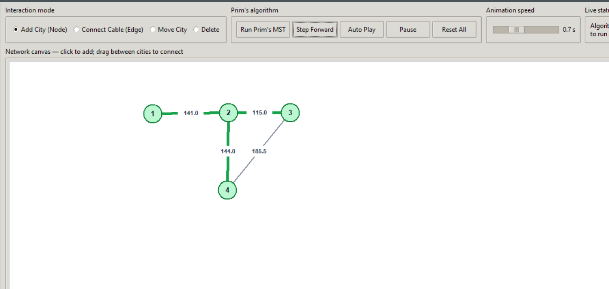
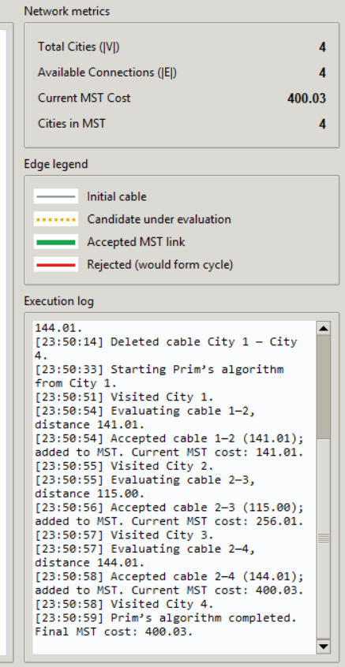

# Interactive Network Routing & Cable Layout
### Prim's Algorithm Visualizer

An interactive desktop application built with **Python 3 and Tkinter** to demonstrate how Prim's Minimum Spanning Tree (MST) algorithm selects connections in a weighted network.

Create cities, connect them with cables, and watch the algorithm construct a minimum spanning tree step by step.

## Screenshots

Add screenshots of the application running on your computer to the `screenshots/` folder, using these filenames:

### Application interface


### Prim's algorithm in action


## Features

- **Interactive network canvas** — add, move, and delete cities.
- **Cable creation** — drag from one city to another to create an edge.
- **Automatic edge weights** — weights are calculated using Euclidean distance between city positions.
- **Prim's MST visualization** — inspect the algorithm step by step or play it automatically.
- **Color-coded edges:** gray for original cables, yellow dashed for candidate edges, green for accepted MST edges, and red for rejected cycle-forming edges.
- **Execution log** — view algorithm decisions and accumulated MST cost.
- **Live metrics** — city count, cable count, visited cities, and MST cost.
- **Adjustable animation speed**.
- **No third-party packages required** — uses Python's standard library.

## Requirements

- Python 3.9 or newer recommended
- Tkinter support (included with most standard Windows Python installations)

No `pip install` step is required.

## Run locally

1. Download or clone this repository.
2. Open a terminal in the project folder.
3. Run:

   ```bash
   python prim_network_routing_visualizer.py
   ```

   On Windows, if `python` is not recognized, try:

   ```bash
   py prim_network_routing_visualizer.py
   ```

## How to use

1. Choose **Add City (Node)** and click the canvas to create cities.
2. Choose **Connect Cable (Edge)** and drag from one city to another.
3. Click **Run Prim's MST** to prepare the algorithm.
4. Click **Step Forward** to inspect individual decisions, or **Auto Play** to animate the process.
5. Use **Pause** to stop playback and **Reset All** to clear the network.
6. Review the execution log and MST cost in the right-hand panel.

### Interaction modes

| Mode | Action |
|---|---|
| Add City (Node) | Click an empty canvas area |
| Connect Cable (Edge) | Drag from one city to another |
| Move City | Drag an existing city |
| Delete | Click a city or cable |

**Note:** Prim's algorithm produces a spanning tree only when the network is connected. Connect all cities before running it. Moving a city changes the lengths of its connected cables.

## Algorithm overview

Prim's algorithm grows a spanning tree from a starting vertex. At each step, it chooses the minimum-weight edge that connects a visited vertex to an unvisited vertex. The process continues until every vertex has been included.

For a connected, undirected weighted graph, the resulting Minimum Spanning Tree contains `|V| - 1` edges when there is more than one vertex.

The edge weights in this visualizer are straight-line pixel distances on the canvas; they are illustrative distances rather than real-world geographic measurements.

## Project structure

```text
prim-network-routing-visualizer/
├── prim_network_routing_visualizer.py
├── README.md
├── LICENSE                 # optional
└── screenshots/
    ├── screenshot-main.png
    └── screenshot-mst.png
```

## Contributing

Suggestions and bug reports are welcome. For substantial changes, open an issue first to discuss the proposed change.

## License

No license has been selected yet. Unless a license is added, normal copyright applies and others do not automatically have permission to reuse, distribute, or modify the project. Add a `LICENSE` file if you want to grant explicit reuse permissions.
